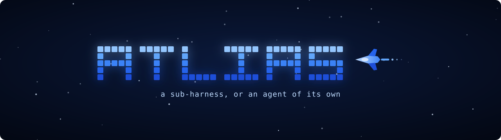

<p align="center"></p>
<p align="center">The coding-agent harness that spends fewer tokens and will not call unfinished work done.</p>
<p align="center">
  <a href="https://github.com/ridelink0/atlias/actions/workflows/test.yml"></a>
  
  
  
</p>

---

### Installation

```bash
# The atlias command, from anywhere
npm install -g github:ridelink0/atlias

# Claude Code
/plugin marketplace add ridelink0/atlias
/plugin install atlias@atlias

# Codex
codex plugin marketplace add ridelink0/atlias
atlias install --codex

# Every other harness already on this machine
atlias install
```

> [!TIP]
> `atlias doctor` checks the whole install. `atlias uninstall` removes exactly what `atlias install` wrote and nothing else.

### Two ways to run it

- **Sub-harness** - inside Claude Code, Codex, Antigravity, Gemini CLI and fourteen other harnesses: a shared memory, a knowledge graph, loop and destructive-command guards, and a gate that holds a reply until the work behind it is real.
- **Agent** - typed as `atlias` in any terminal, driving Claude Code, Codex, any OpenAI-compatible endpoint or a local Ollama model through a tool loop built around what weaker models get wrong.

```bash
atlias                     # choose, then fly
atlias exec "fix the failing test"
atlias mode both           # or sub, or standalone
```

No dependencies. Node 18 or newer.

### Benchmarks

Use your own API endpoint, model and optional token prices with the native
subharness: `atlias sub --host claude|codex --profile provider.json`. Follow-ups
stay in the native session. See [API setup and measured cost estimates](docs/API-SUBHARNESS.md)
for supported protocols, credentials and resume commands. These optional
features do not establish a 20x benchmark result.

Every number below was measured, on one consumer PC, with a local 9-billion-parameter model (`qwen3.5:9b` through Ollama, a 16,384-token window, replies capped at 2,048 tokens). A task counts as solved only when its hidden check, a command, exits 0; what the model says about its own work never scores. Tokens per solve is every prompt and output token of the run divided by the tasks solved.

#### Against other harnesses

The same 60 tasks, model, window, step budgets and grader for every row (2026-10-12).

| Harness | Solved | Tokens per solve | Largest prompt |
| --- | --- | --- | --- |
| **atlias 3.8.1** | **44 / 60** | **30,007** | **7,578** |
| mini-swe-agent | 41 / 60 | 34,174 | 11,734 |
| nanobot 0.3.5 (stock) | 40 / 60 | 92,348 | 13,298 |
| OpenCode (stock) | 38 / 60 | 62,831 | 12,671 |

Read it the way it was measured:

- **The solve counts are inside the noise.** The same atlias configuration solved 39 of these 60 tasks in a second run, so 41.5 is its honest centre; nanobot and OpenCode split 6 to 4 on the tasks only one of them solved, which chance alone does three times in four.
- **The token counts are not close.** atlias spent about a third of what nanobot did for each solved task and about half of what OpenCode did.
- mini-swe-agent's 34,174 counts its assistant replies only; with the 22 replies its runner does not count it is 36,237.
- 47 of the 60 tasks were solved by at least one harness, 30 by all four, 13 by none.

#### Full corpora

Every task of seven benchmark sets, 596 in all, one run each (2026-10-10 and 2026-10-11).

| Set | Solved | Tokens per solve |
| --- | --- | --- |
| HumanEvalFix, Python | 136 / 164 | 23,721 |
| HumanEvalFix, JavaScript | 121 / 163 | 22,781 |
| CanItEdit, descriptive instructions | 51 / 88 | 49,072 |
| CanItEdit, lazy instructions | 39 / 88 | 61,848 |
| Aider refactor, graded on the syntax tree | 24 / 57 | 255,560 |
| Aider polyglot, Python | 13 / 27 | 202,147 |
| atlias's own nine plumbing tasks | 9 / 9 | 16,201 |
| **All** | **393 / 596 (65.9%)** | **50,393** |

Two larger fixed samples of the main tier: 178 of 250 (71.2%) at 30,296 tokens per solve, and 88 of 120 (73.3%) at 30,159.

#### Where the tokens go

Measured on the 60-task run above:

| Finding | What atlias does about it |
| --- | --- |
| The opening block (system message, tool list, task) is re-sent on every call: **48.8% of all prompt tokens**, at 8.4 calls a task | It is the first place to cut |
| An index of installed skills was about 1,440 characters of that block, and no run used a skill | `agent.skillIndex` is **off by default**; `relevant` names at most five skills that share words with the request and says how to list the rest |
| Four of eleven tools are 45% of the tool list a model reads in text mode (1,195 characters down to 659), and 42% of the schemas in native mode | `agent.toolSet core` offers the other seven; off until a paired run shows no loss |
| 80% of prompt tokens were served from the model server's cache | Old tool results are masked in blocks, so the cached prefix survives |

A change like these is kept only when a paired run shows fewer tokens with no loss of solved tasks. `atlias compare a.json b.json` does the pairing: which tasks flipped, and whether a coin could have done it.

#### Inside Claude Code

`atlias bench`, on atlias's own repository: the session brief costs about 1,000 tokens once per session, and one knowledge-graph answer about 600 tokens against an upper bound of about 26,000 for opening in full the files that answer names.

#### What has not been measured

- Whether atlias changes how many tasks Claude Code or Codex finish. Their engines run their own conversations and atlias never sees their token counts.
- Any model other than the one above, at any scale beyond these tasks.
- Every row is one run unless it says otherwise. A lead in a single run is a lead, not a result.

Reproduce any of it: `atlias tiers` lists the benchmark sets and how to fetch them, `evals/CORPORA.md` has every source and licence, and `atlias eval --tier main --sample 60 --seed s --save a.json` runs one.

### What it catches

The most expensive thing an agent does is say it finished when it did not. atlias checks the claim against what happened in the session and holds the reply once, with every finding in one message:

| The agent | atlias sees |
| --- | --- |
| says the tests pass, but ran none | a pass claimed with no test run on record |
| says the tests pass after a failing run | the failure, quoted from the run's own output |
| says done after an edit, with no check since | no verification after the last edit |
| leaves `TODO`, `...rest of the code`, placeholder data | the lines, from the diff |
| skips, focuses or deletes a test, or asserts `true` | the weakened test, from the diff |
| adds a function nothing calls | the definition, and that no other line names it |
| saves a file that does not parse | the parser's own error |
| repeats a call, or swaps between two calls | the loop, stopped with what to change |
| runs `rm -rf ~`, a force push, a dropped table | a question to the user first |

Nothing it did not check is claimed: a file it cannot parse is named as unchecked, and a test run it cannot read is recorded as unknown, never as a pass.

### Tests

```bash
node test/run.mjs
```

1,271 checks in 192 suites, each failure printed as what happened, why it matters and how to fix it. A coverage suite fails the run if any exported function has no test of its own. CI runs everything on Linux, macOS and Windows under Node 18, 20 and 22.

### Documentation

- [The guide](docs/GUIDE.md) - the agent and its engines, what atlias does in every host, scoring a harness, the sandbox, settings, skills, updates and versioning
- [Research](docs/RESEARCH.md) - where each mechanism comes from and what is still unmeasured
- [The benchmark ledger](docs/ULTIMATE-BENCHMARK.md) - every benchmark family and the evidence each one needs
- [Corpora](evals/CORPORA.md) - sources, licences and how to regenerate each set

### Known limits

- The OpenAI-compatible engine is tested against a local server that speaks the wire format, not against a live paid endpoint in CI.
- The extra harnesses' config shapes follow each tool's documentation and are marked UNVERIFIED in `lib/hosts-extra.mjs`; only Claude Code and Codex are pinned to source.
- Antigravity has no hook API, so it gets the MCP server and the instruction block only.

### Built on

[HKUDS nanobot](https://github.com/HKUDS/nanobot) for the memory and Dream design, [graphify](https://pypi.org/project/graphifyy/) for the knowledge graph, [ultimate-frontend-skills](https://github.com/ridelink0/ultimate-frontend-skills) for frontend work, and the sources in [docs/RESEARCH.md](docs/RESEARCH.md). The name is a tribute to atelier, the art-direction plugin that became Ultimate Frontend Skills.

---

**MIT. Built by Gev.**
